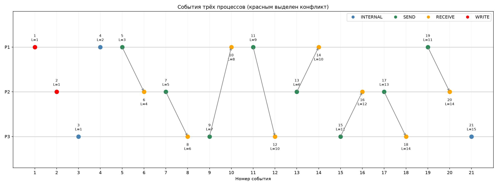

# Лабораторная №2. Логические и векторные часы

Здесь мы моделируем три процесса P1, P2, P3, которые обмениваются сообщениями. У каждого процесса есть свои часы Лэмпорта и векторные часы, по которым можно определить порядок событий и найти конфликты.

## Для запуска симуляции нужно:

Открываем терминал в папке проекта и запускаем:

```powershell
uv run python main.py
```

Никакие серверы запускать не нужно, здесь мы просто симулируем процессы. После запуска в терминале появится таблица событий, количество причинно-связанных и конкурентных пар, а также результаты разрешения конфликта.

График и csv таблички сохраняются в папку `graphs`:

- `events.csv` — все события с часами Лэмпорта и векторными часами;
- `causal_pairs.csv` — пары событий, где одно произошло раньше другого;
- `concurrent_pairs.csv` — события, между которыми нет причинной связи;
- `time_space.png` — диаграмма трёх процессов со стрелками сообщений.

Если нужно проверить работу часов и хранилища отдельно, запускаем тесты:

```powershell
uv run pytest -q
```

## Что получилось



На диаграмме три линии — наши процессы. Точки показывают события, а стрелки — откуда и куда передавались сообщения. Красные точки в начале — два конфликтующих обновления x.

В нашем сценарии получилось 21 событие и 210 пар событий: 180 причинно-связанных и 30 конкурентных. Процессы обменялись 8 сообщениями. P1 и P2 независимо изменили одно значение x=0: первый сделал x+1=1, а второй x*2=0. Их векторные часы `[1, 0, 0]` и `[0, 1, 0]` нельзя упорядочить, поэтому мы обнаруживаем конфликт.

Проверяем два способа разрешения конфликта:

- **LWW:** берём последнее полученное обновление от P2, получается x=0.
- **Merge:** складываем полученные значения 1+0, получается x=1. Для строк проверяем объединение через `|`.

## Небольшой вывод

Часы Лэмпорта позволяют упорядочивать события, но не всегда говорят, связаны ли они между собой. Векторные часы уже позволяют находить причинно-следственные связи и одновременные обновления.

Если нам важно просто брать последнее изменение, можно использовать LWW, но мы можем потерять предыдущую запись. Merge в нашей задаче сохраняет оба значения, но складывать данные подобным образом можно не всегда, тут всё зависит от конкретной задачи.
